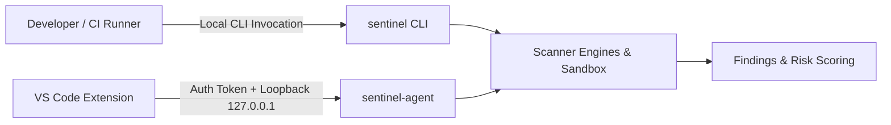

# Sentinel Security Model & Threat Architecture

This document defines the security boundaries, assets, threats (STRIDE), and architectural controls governing the Sentinel DevSecOps scanner, its daemon (`sentinel-agent`), and the VS Code IDE extension.

---

## 1. Core Security Invariants

1. **Zero Source Code Egress**: All security analysis (SAST, SCA, secrets, IaC, and resilience) executes 100% locally on the developer machine or self-hosted CI runner. Zero source code, snippets, or AST representations ever leave the local runtime environment.
2. **Local-Only Inter-Process Communication**: The agent daemon binds strictly to `127.0.0.1:48921` over loopback TCP. Public interfaces are never bound.
3. **Cryptographic Session Authentication**: Every connection and JSON-RPC message to `sentinel-agent` requires a valid 192-bit cryptographic session token stored with restrictive `0600` permissions.
4. **Defense Against Hostile Repositories**: Scanned source code must be treated as untrusted input. Opening or scanning a hostile repository must never execute arbitrary code on the developer's workstation.
5. **Passive-Only DAST with Strict Boundaries**: Runtime dynamic scanning is restricted to passive HTTP header/misconfiguration analysis. Active probing requires explicit flags and allowlist validation, with RFC 1918 private IP addresses blocked by default.

---

## 2. Protected Assets

| Asset | Description | Sensitivity |
|---|---|---|
| **Developer Source Code & AST** | Proprietary source code, abstracts, and intellectual property. | High |
| **Secrets & Credentials** | API keys, tokens, certificates, and private keys found in scanned repos. | Critical |
| **IDE Host Environment** | The user's developer workstation, shell, filesystem, and processes. | Critical |
| **Security Gating Configuration** | `.sentinel.yml` policy files defining acceptable vulnerabilities. | High |
| **DAST Target Services** | Network endpoints authorized for passive security checks. | High |

---

## 3. STRIDE Threat Analysis & Architectural Controls

### 3.1 Spoofing (Identity & Origin)
* **Threat**: A rogue process on the developer machine connects to `sentinel-agent` and issues unauthorized scan or file modification commands.
* **Mitigation**:
  - The daemon generates a random token (`crypto/rand`) at launch and writes it to a file with `0600` permissions accessible only to the running user.
  - Every JSON-RPC request must supply this session token. Unauthenticated requests are rejected immediately with error code `-32001`.
  - The handshake protocol (`agent.handshake`) verifies mutual version compatibility.

### 3.2 Tampering (Data & Command Injection)
* **Threat A**: A hostile repository crafts a malicious finding message containing embedded `command:` links (e.g. `[Fix](command:workbench.action.terminal.sendSequence?...)`) to achieve arbitrary code execution via hover cards in VS Code.
* **Mitigation A**:
  - The extension explicitly configures `md.isTrusted = { enabledCommands: ['sentinel.showFindingDetails', 'sentinel.applyFix'] }`. Blanket trust is prohibited.
  - All untrusted finding messages and snippets are disarmed via `sanitizeUntrustedText()` and appended via `md.appendText()`.
* **Threat B**: An untrusted pull request modifies `.sentinel.yml` to suppress all critical findings.
* **Mitigation B**:
  - In CI mode (`--ci`), Sentinel ignores `.sentinel.yml` found inside the scanned repository by default unless `--trust-repo-policy` is explicitly provided. CI pipelines should specify `--config` pointing to a trusted, base-branch configuration.

### 3.3 Repudiation (Accountability)
* **Threat**: Team members bypass security gates by adding silent suppressions without justification or audit trails.
* **Mitigation**:
  - Every suppression in `.sentinel.yml` strictly requires an explanatory `reason` field. Configs with empty reasons are rejected with an error.
  - Optional `expires` date tags automatically re-enable findings once temporary exemptions lapse.

### 3.4 Information Disclosure (Leakage)
* **Threat**: Detected credentials or secrets are printed in cleartext into shared CI build logs or reports.
* **Mitigation**:
  - All secret snippets (AWS keys, GitHub tokens, Slack webhooks) are automatically masked via `orchestrator.RedactSecret()` (e.g. `AKIA***PLE`), preventing credential disclosure.

### 3.5 Denial of Service (Scanner Starvation)
* **Threat**: A repository contains oversized files, deeply nested directories, circular symlinks, or malformed lockfiles designed to crash or hang the scanner.
* **Mitigation**:
  - Directory traversal enforces depth caps and ignores circular symlinks.
  - Oversized minified binaries and files over threshold limits are skipped during AST extraction.
  - Malformed lockfiles and policies return structured errors without crashing or panicking.

### 3.6 Elevation of Privilege (Container & Host Breakout)
* **Threat**: Scanned code or malicious tools exploit scanner privileges to take over the container or host.
* **Mitigation**:
  - Official Docker images run as an unprivileged, non-root user (`USER 10001:10001`).
  - The VS Code extension honors the Workspace Trust API; scanning is completely gated until the user explicitly grants trust to the opened workspace.
